# 清笺课程表

从学校教务系统取得课程表（安卓版可在应用内**直连读取**，或导入导出的课程表 Excel），自动解析成一张完整、直观的课表。

不联网、不上传、不收集任何信息，所有数据只保存在本机。

---

## 这是什么

「清笺课程表」是一个本地运行的课程表应用。导入教务系统导出的课程表 Excel 后，它会自动识别表格结构、拆出每门课的上课时间与地点，生成一张可以按周查看的课表，不需要手工录入。

有两种使用方式：

| 版本 | 说明 |
|---|---|
| **安卓版** | 完整功能。数据除本地存储外，还会在应用私有目录保存一份，清理后台不会丢失。 |
| **网页版** | 单个 HTML 文件，双击即可用。不依赖网络，也可以添加到手机主屏幕当作应用使用。 |

## 功能

**课程表**

- 自动识别三种常见的教务系统导出格式：大节网格表、通用网格表、课程明细表；`.xls` 与 `.xlsx` 均支持（按文件内容判断格式，不依赖扩展名）
- 按周查看，可在任意周次之间切换；当前周没有课时自动跳到最近有课的一周
- 课程块按课程名自动配色，同一门课颜色一致
- 点击课程块查看详情：时间、地点、教师、周次
- 日程视图：当天的课程与**手动添加的日程**混排成一条时间线，按开始时间排序
- 添加日程：名称、日期、起止时间、地点、备注、配色，可选**提前 5 分钟 ~ 提前 1 天**提醒；随时编辑或删除
- 上下课时间表可自定义，大节会按总时长自动拆分

**多课程表**

- 可分别保存不同学期或不同班级的课程表，随时切换
- 导入时可选「覆盖当前课程表 / 另外开一个课程表 / 合并到当前课程表」

**个人化**

- 昵称、头像、个性签名、生日
- 9 套预设主题，也可以自定义主色与辅色
- 深色模式
- 自定义界面背景图

**导入**

- **从教务系统导入**（安卓版）：内置**两百余所高校**的教务系统适配，按**类别页签**（本科 / 高职、研究生、通用系统）分栏展示，每所学校下方标注它所属的教务系统类别。**点学校名即直接打开**教务系统 → 登录 → 应用自动读取课表；列表外的学校可自行选择系统类型并填写网址。打开后想改主意，按返回键会回到学校列表，不会被丢回课表页。**不保存账号密码**，每次手动登录
- 导入教务系统导出的课程表 Excel（`.xlsx` / `.xls` 均支持，按文件内容判断格式）
- 内置「**导入教程**」，分「从教务系统导入」与「导入 Excel 文件」两块，各自独立步骤（不针对某一所学校）
- 下载导入模板

**数据**

- 导出 `.ics` 日历文件，可导入手机自带日历、谷歌日历或 Outlook（课程与手动添加的日程都会导出）
- **同步到系统日历**（安卓版）：添加日程时打开开关即可写进手机自带的日历，带提前提醒；修改日程会先删旧再写新，取消同步或删除日程时也会清掉系统日历里的那条。没给权限或没有可写入的日历账户时会说明原因，日程仍保存在应用内
- 导出课表为图片
- 导出备份与从备份恢复
- 上课提醒

**设置**

「我的 → 设置」按用途分成 6 个模块，每个模块单独一页，不用在一长条列表里翻找；一级列表上直接显示当前状态（第几周、当前主题、提醒时间等）。

| 模块 | 内容 |
|---|---|
| 学期与节次 | 本周是第几周 / 第 1 周周一 / 总周数 / 学期，以及上下课时间表 |
| 外观 | 深色模式、显示周末、主题色与自定义主色、界面背景图 |
| 上课提醒 | 提前提醒的时间 |
| 数据 | 导入 Excel、导出图片 / 日历 / 备份，从备份恢复、清空 |
| 检查更新 | 查询项目发布记录，可选国内镜像下载并直接调用系统安装器 |
| 关于 | 版本号、开发者署名、开源声明、兼容性说明与隐私政策 |

## 界面

| 课表 | 课程详情 | 日程 |
|---|---|---|
| 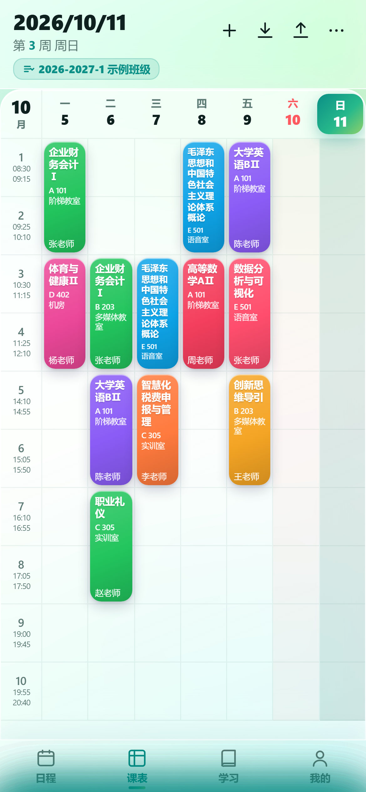 | 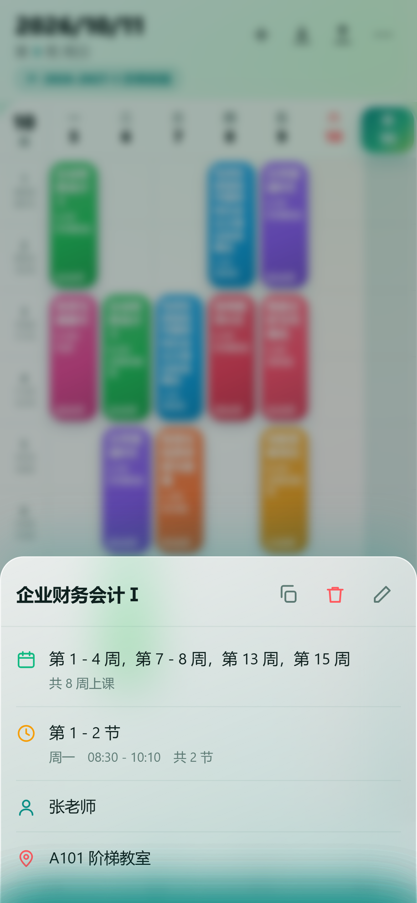 |  |

| 添加日程 | 导入向导 | 导入教程 |
|---|---|---|
| 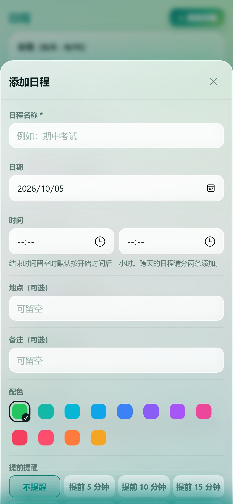 | 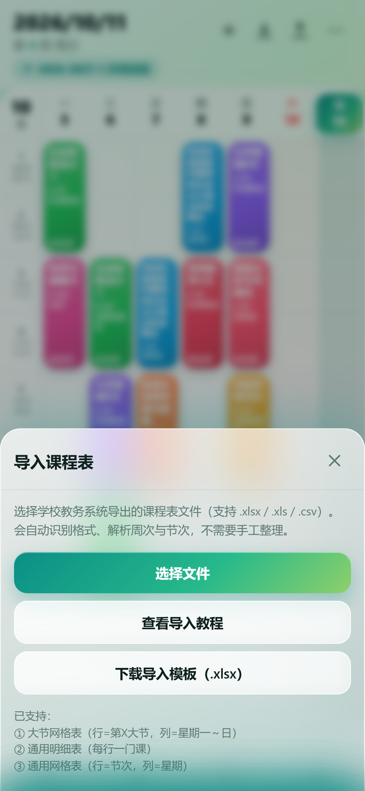 | 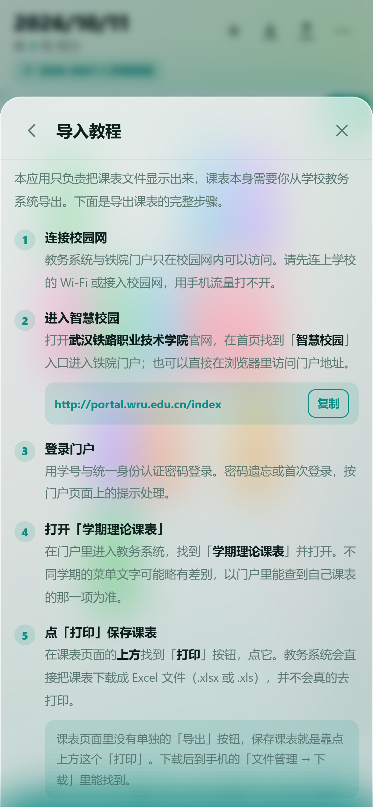 |

| 设置（一级分类） | 检查更新 | 关于与隐私政策 |
|---|---|---|
| 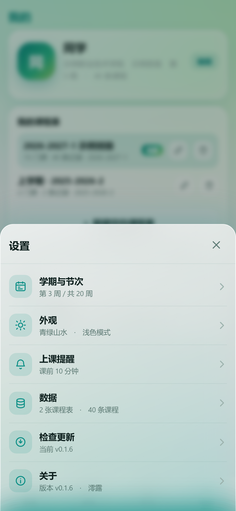 | 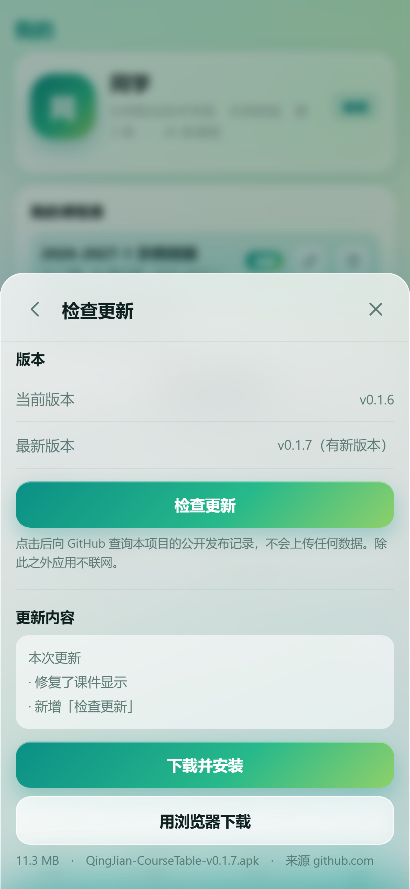 | 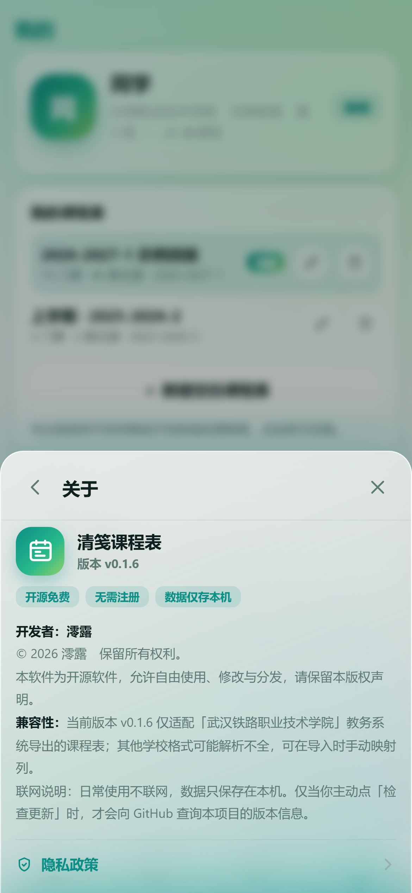 |

| 外观设置 | 自定义背景 | 深色模式 |
|---|---|---|
| 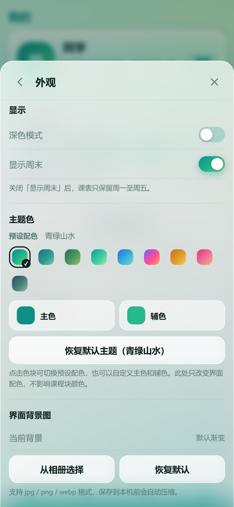 | 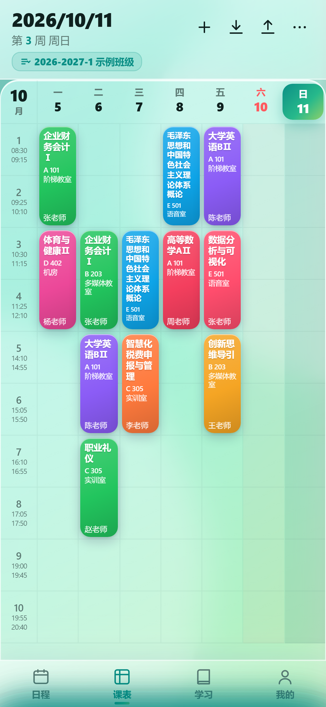 | 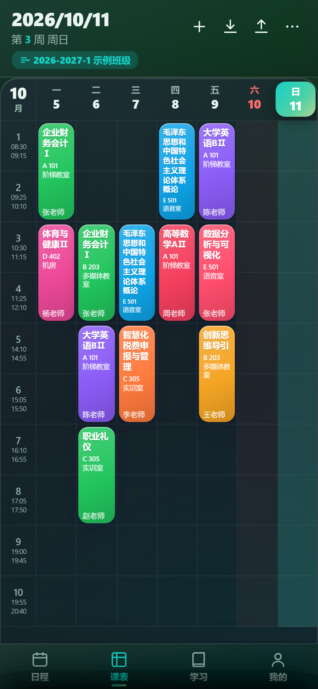 |

| 当周无课 | 主题色 · 海天 | 主题色 · 琥珀 |
|---|---|---|
| 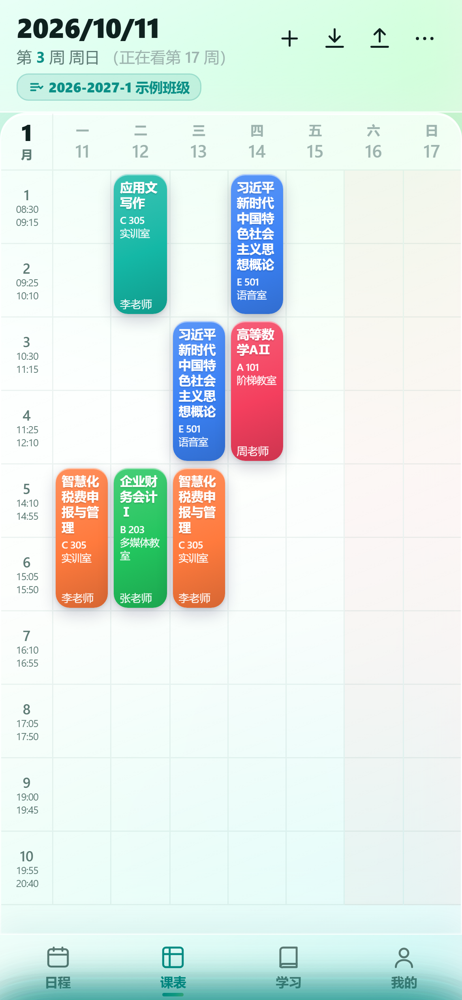 | 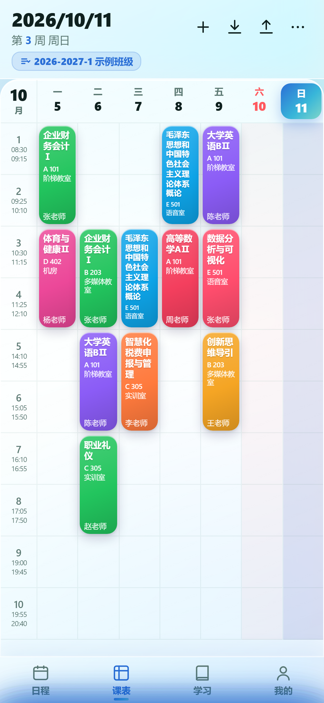 | 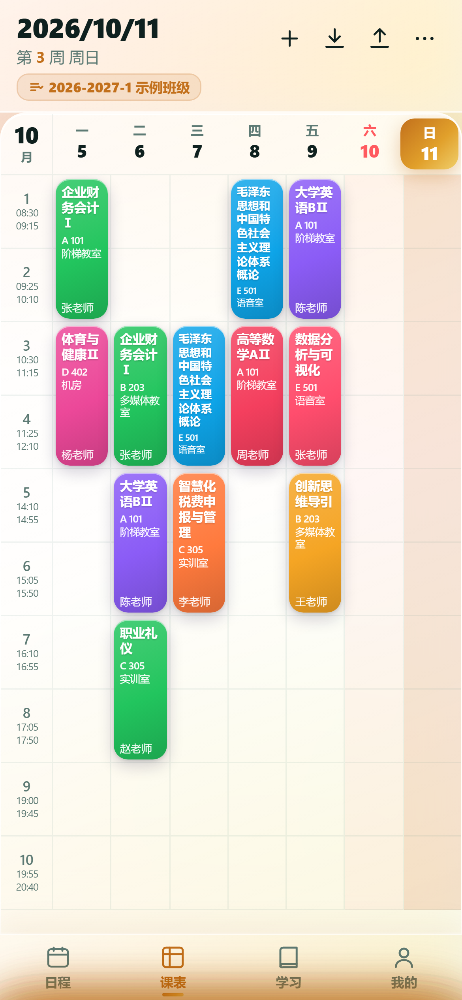 |

更多界面见 `预览图/` 目录。

## 下载与安装

### 安卓版

到 [Releases](../../releases/latest) 下载 `QingJian-CourseTable-v0.1.6.apk`。

- 需要 **Android 10（API 29）及以上**
- 安装时系统可能提示「未知来源」，允许即可
- 安装包声明四项权限：`INTERNET`（仅在你主动点「检查更新」时使用）、「安装未知应用」（仅用于把下载好的新版安装包交给系统安装器）、以及 `READ_CALENDAR` / `WRITE_CALENDAR`（**只在添加日程并打开「同步到系统日历」时**才向系统申请，用于把日程写进手机自带的日历、并读取有哪些可写入的日历）。没有相机、相册、存储、定位权限（选图走系统相册选择器，应用本身不申请相关权限）

### 网页版

下载 `清笺课程表.html`，双击用浏览器打开。单文件自包含，不需要联网，不需要安装任何东西。

## 从源码构建

### 网页版

```bash
node build-single.js
```

该脚本读取 `index.html` 与同目录的 `xlsx.full.min.js`，合成为自包含的 `清笺课程表.html`。修改 `index.html` 后需要重新执行。

### 安卓版

需要 JDK 17 与 Android SDK 34。

```bash
cd android-app
npm install
npx cap copy android
cd android
./gradlew assembleRelease
```

产物位于 `android-app/android/app/build/outputs/apk/release/app-release.apk`。

> 只改网页资源时用 `npx cap copy android`（秒级），不要用 `cap sync`：本机沙箱的批量删除保护会打断 `cap sync` 并删掉 `android/capacitor-cordova-android-plugins/` 的源文件，导致后续构建失败。新增**独立 Gradle 模块**形式的原生插件时改为手工登记三处（`android/capacitor.settings.gradle`、`app/capacitor.build.gradle`、`app/src/main/assets/capacitor.plugins.json`）；本项目的两个自写插件（`zwbridge/`、`calbridge/`）直接放在 app 模块内，不需要这三处，只要在 `MainActivity.onCreate` 里 `super.onCreate` **之前** `registerPlugin(...)` 即可。

签名信息从 `android-app/android/keystore.properties` 读取。该文件包含密钥口令，不在仓库中，需自行创建：

```properties
storeFile=qingjian-release.jks
storePassword=你的口令
keyAlias=你的别名
keyPassword=你的口令
```

没有该文件时构建仍会通过，但只产出未签名包，无法安装。

> 注意：更新版本必须沿用同一支签名密钥，否则已安装的用户需要先卸载才能安装新版，本地数据会一并清除。

## 测试

需要 `jsdom` 与 `xlsx` 两个依赖：

```bash
npm install jsdom xlsx
```

先启动一个静态服务器，再运行脚本：

```bash
python -m http.server 8765

node dev/verify.js       http://127.0.0.1:8765/清笺课程表.html
node dev/feature-test.js http://127.0.0.1:8765/index.html
node dev/native-test.js  http://127.0.0.1:8765/清笺课程表.html
node dev/uni-test.js     http://127.0.0.1:8765/清笺课程表.html
```

| 脚本 | 作用 |
|---|---|
| `verify.js` | 单文件验收：零报错、依赖库加载、核心函数存在、本地存储可用 |
| `feature-test.js` | 功能端到端测试（211 项）：多课程表、导入三选项、导入教程的两个分栏、个人资料（含默认头像留白）、背景图、ICS 导出、主题色、周次换算、设置二级模块与隐私政策、检查更新（含镜像回退）、添加日程与删除/编辑、标题行按钮文字可见性、备份深校验（损坏数据过滤/节次钳制/颜色清洗/日程过滤） |
| `native-test.js` | 安卓原生行为模拟（95 项）：注入模拟的 Capacitor 与虚拟文件系统，验证数据持久化恢复、返回键分层、状态栏配色、相册选图与回退、更新包下载与拉起安装器（含 SHA-256 完整性校验）、教务系统直连导入、日程同步系统日历（含权限被拒/无可写日历/写入报错的降级、跨天日程） |
| `uni-test.js` | 多校导入测试（97 项）：学校清单由插件提供、按类别页签分栏、按校名 / 代号跨类别搜索（含输入法 `compositionend` 与回车两条刷新路径）、点学校即打开教务系统、取消后回到学校列表、缺网址时拦截、两条链路（本校直连 / 其他学校走适配脚本）分发 |
| `_repro.js` | 课程块布局复现：用真实 Excel 渲染后逐块断言，默认字号与放大 1.3 倍两轮都不裁字 |
| `verify-ics.py` | 用 `icalendar` 库实际解析导出的 `.ics`，校验格式是否符合 RFC 5545 |

## 项目结构

```
清笺课程表.html              交付用单文件（由 build-single.js 生成）
index.html                   网页版源码，依赖同级 xlsx.full.min.js
xlsx.full.min.js             SheetJS，用于解析 Excel
build-single.js              单文件合成脚本
使用说明.md                   面向使用者的完整说明

历史版本/                     历代 APK 安装包（按版本号命名，仅供留档对照）
  清笺课程表-v0.1.6.apk       当前版本（也放在此处，根目录不再另存一份）

android-app/                 Capacitor 安卓壳工程
  www/                       同步过来的单文件
  android/                   原生工程，用 Gradle 构建
    app/src/main/java/com/reiro/qingjian/
      zwbridge/                自写插件：应用内打开本校教务系统并读回课表
      uniimport/               自写插件：多校导入（注入适配脚本、回传课表）
      calbridge/               自写插件：把日程写进手机自带的日历
    app/src/main/assets/uniimport/   内置两百余所学校的适配脚本与网址（离线随包）

dev/                         开发与验证脚本
  make-demo.js               生成脱敏的演示页，用于截图核对
  shoot.js                   批量截图到 预览图/
  sync-android-web.js        把单文件同步进 android-app/www/
  make-android-icons.py      生成应用图标与启动图
  fetch-schools.py           同步「拾光课程表」的学校清单与适配脚本
  verify-ics.py              .ics 格式校验
  uni-test.js                多校导入测试

预览图/                       各页面截图
```

## 数据与隐私

- **不收集任何信息**：没有账号体系，不需要手机号或邮箱，没有埋点统计、广告或行为分析
- **数据只保存在本机**：课程表、个人资料、头像、背景图、主题设置只写入设备本地存储；安卓版额外写入应用私有目录，用途仅是防止系统清理导致数据丢失
- **权限只在必要时使用**：只有你主动选择文件时才读取你选中的那一个文件；选图走系统相册选择器，应用本身不申请相册或相机权限；通知权限只用于上课提醒，可随时关闭
- **日历权限只在你打开「同步到系统日历」时申请**：用于写入你新建的那条日程、并读取有哪些可写入的日历账户；不读取、不上传你已有的任何日程
- **联网只在两处**：一是「检查更新」连接 GitHub 查询版本，二是「从教务系统导入」连接你所选学校的教务系统网页（账号密码由你自行输入，应用不接触）。两者都只在你主动操作时发生，不上传任何数据
- **不含任何第三方 SDK**

完整说明见应用内「设置 → 关于 → 隐私政策」。

## 兼容性

解析器可自动识别教务系统常见的几种课表格式（大节网格表 / 通用明细表 / 通用网格表），列名不标准时会引导你手动对应。**安卓版**另内置两百余所高校的教务系统直连导入适配（适配脚本取自开源项目「拾光课程表」的脚本仓库，MIT 许可，Copyright (c) 2025 星河欲转），列表外的学校也可自行选择系统类型与网址。

## 开发者

澪露

## 许可证

[MIT License](LICENSE)　© 2026 澪露
